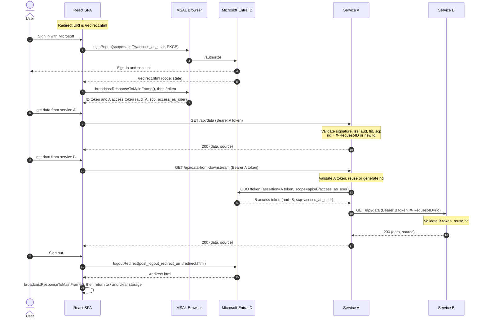

# Microsoft Entra ID OBO Demo

A three-service demo of Microsoft Entra ID sign-in, protected APIs, and the
On-Behalf-Of (OBO) flow:

| Service | Tech | Port | Role |
|---|---|---|---|
| `apps/client` | React + TypeScript + Vite + MSAL | 5173 | SPA sign-in, calls Service A |
| `apps/service_a` | FastAPI + Python | 8001 | Upstream API, performs OBO for Service B |
| `apps/service_b` | FastAPI + Python | 8002 | Downstream API |

Endpoints:

- `GET /api/data` (both services) → `{"data": "...", "source": "service-a|service-b"}`
- `GET /api/data-from-downstream` (Service A) → calls Service B through OBO and returns its `{data, source}`
- `GET /health` (both services, public)

## Sequence diagram



Service A generates the request ID at its API boundary (or reuses a valid
inbound `X-Request-ID`) and forwards it to Service B, so the auth, OBO,
downstream-call, and Service B logs share the same `rid`.

## Entra app registrations

Three single-tenant app registrations are required:

- **SPA**: platform `Single-page application`, redirect URI
  `http://localhost:5173/redirect.html`; delegated permission to Service A's
  `access_as_user` scope with admin consent.
- **Service A**: expose `api://<A-client-id>/access_as_user`; client secret;
  delegated permission to Service B's `access_as_user` scope with admin consent;
  add the SPA as an authorized client application.
- **Service B**: expose `api://<B-client-id>/access_as_user`; add Service A as an
  authorized client application.

Use the same tenant ID in all three `.env` files.

## Configuration

Create each `.env` from its template if it does not exist yet, then fill in the
values:

```bash
cp -n apps/client/env.example    apps/client/.env
cp -n apps/service_a/env.example apps/service_a/.env
cp -n apps/service_b/env.example apps/service_b/.env
```

`LOG_LEVEL` (default `INFO`) controls application logs. It does not affect
uvicorn access logs; use `--log-level` for those.

## Run

```bash
# Terminal 1
cd apps/service_b
uv sync
uv run uvicorn app.main:app --reload --port 8002

# Terminal 2
cd apps/service_a
uv sync
uv run uvicorn app.main:app --reload --port 8001

# Terminal 3
cd apps/client
npm install
npm run dev
```

Open <http://localhost:5173>, sign in, and use the two data buttons.

## Logging

Application logs are written to stdout alongside uvicorn access logs:

```text
12:34:56 | INFO    | app.auth | AUTH OK | rid=7f3a9c1d2e4b | GET /api/data | scheme=Bearer | token_tail=<last6> | kid=... | aud=api://... | iss=https://login.microsoftonline.com/<tid>/v2.0 | scp=access_as_user | oid=... | tid=... | ver=2.0 | azp=...
12:34:56 | INFO    | app.obo  | OBO START | rid=7f3a9c1d2e4b | scope=api://.../access_as_user | assertion_tail=<last6>
12:34:56 | INFO    | app.obo  | OBO OK | rid=7f3a9c1d2e4b | scope=api://.../access_as_user | token_source=identity_provider | expires_in=3600 | correlation_id=... | downstream_token_tail=<last6>
12:34:56 | INFO    | app.main | DOWNSTREAM OK | rid=7f3a9c1d2e4b | GET http://localhost:8002/api/data | status=200 | duration_ms=12.4 | bytes=52
```

Validation failures and OBO errors are logged at `WARNING`/`ERROR` with the
same `rid`, a reason, and the relevant claims. Full tokens, client secrets, and user PII
(email, name, UPN) are never logged; token values are reduced to their last 6
characters.
